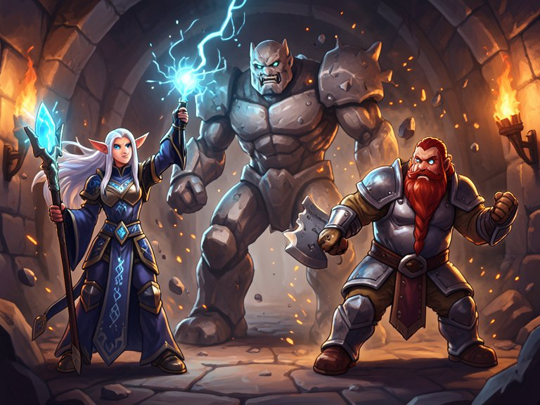

# Generated Adventures

[](https://github.com/MarekLipan/generated-adventures/actions/workflows/ci.yml)

A tabletop-style fantasy adventure for one or more players, run by an LLM acting
as dungeon master. It invents the scenario, follows what your party does, and
keeps track of health, items and skills. Every scene is illustrated by an image
model that keeps each hero recognizable, and narrated aloud with a different
voice for each character.



*A two-character scene rendered locally with FLUX.2 Klein on an Apple Silicon Mac. Each hero
keeps the face and gear from their portrait.*

## Features

- **Scenarios on demand:** pick a genre (classic fantasy, dark fantasy, mystery)
  and stakes (a local problem up to world-ending), and get a fresh adventure
  with its own setting, plot and characters.
- **Your own heroes:** choose an archetype and an art style, and optionally
  upload a photo so your hero has your likeness. Photos are only used by the
  local image model unless you explicitly allow cloud upload.
- **Consistent illustrations:** scenes are rendered with the heroes' portraits as
  references, so characters look the same from scene to scene.
- **Narration:** each scene is read aloud, with a consistent voice for every
  character who speaks.
- **A real game:** dice checks, health, inventory and skills that change as the
  story unfolds, and endings where the quest succeeds or the party falls.
- **Pick up later:** games save after every turn; a narrated recap catches you up
  when you come back. Character sheets export to PDF.

## How it works

A NiceGUI web app sits on top of a game engine. Each turn, the engine sends the
story so far to the LLM, which replies with structured data: the scene text, any
changes to the party, who is in frame and who speaks. The engine applies the
changes, then renders the illustration and the narration in parallel.

Text comes from Gemini (or any OpenAI-compatible server, such as Ollama). Images
come from FLUX.2 Klein running locally, or from Gemini. Narration comes from
Kokoro running locally, or from Gemini.

**Architecture:** [docs/architecture.md](docs/architecture.md) has diagrams of the
components, one game turn, the data model and the model backends, plus a module
guide.

## Getting started

You need [uv](https://docs.astral.sh/uv/) and a
[Gemini API key](https://aistudio.google.com/apikey) for the story text.

```bash
git clone https://github.com/MarekLipan/generated-adventures.git
cd generated-adventures
cp .env.example .env    # then set GOOGLE_API_KEY
```

### Local images and narration (default)

Needs an NVIDIA GPU with about 10 GB of VRAM, or an Apple Silicon Mac with 32 GB.

1. `uv sync` installs everything, including PyTorch and the model libraries.
2. FLUX.2 Klein is gated on Hugging Face. Accept its license on the
   [model page](https://huggingface.co/black-forest-labs/FLUX.2-klein-9B), then
   in `.env` set `HUGGING_FACE_HUB_TOKEN` and `IMAGE_HF_OFFLINE=false` for the first
   run, which downloads about 32 GB. After that the app runs from the local cache.
3. Download the narration model files as described in
   [docs/narration.md](docs/narration.md).
4. **On a Mac**, also set `FLUX_KLEIN_GGUF_TRANSFORMER` (see `.env.example`). It
   cuts image time from about 9 minutes to 2–4; see
   [docs/apple-silicon.md](docs/apple-silicon.md).

### Cloud only

No GPU needed. Skip the local model libraries and use Gemini for everything:

```bash
uv sync --no-group local-image --no-group local-tts
```

and in `.env` set `IMAGE_PROVIDER=gemini` and `TTS_PROVIDER=gemini` (or `none`).
Gemini image generation requires billing to be enabled on your API key.

### Play

```bash
uv run adventures
```

and open http://127.0.0.1:8000. Use `--host 0.0.0.0` to open it from another
device on your network, or `--reload` while developing.

To render images on a desktop GPU while playing on a laptop, run
`uv run adventures-image-server` on the desktop. See
[docs/image-server.md](docs/image-server.md).

## Performance

Time per image with FLUX.2 Klein 9B (4 steps):

| Hardware | Setup | Portrait | Scene |
|---|---|---|---|
| NVIDIA GPU, 10 GB VRAM | bitsandbytes NF4 | about 12–20 s | about 12–20 s |
| Apple Silicon Mac, 32 GB | GGUF Q2_K transformer | about 2 min | about 4 min |

The NVIDIA figures come from the project's development notes and the Mac figures
from `scripts/benchmark_images.py`; times vary with the exact GPU or chip. Run
the script to measure your own hardware.

## Development

```bash
uv run pytest                  # tests (live API tests are opt-in: -m live)
uv run ruff check .            # lint
uv run ruff format --check .   # formatting
uv run pyrefly check           # types, against pyrefly-baseline.json
uv run lint-imports            # architecture rules (docs/architecture.md)
```

CI runs all of these on every push.

```
src/generated_adventures/
  core/              game engine: state, generation, prompts, media, model backends
    generation/      LLM steps: scenarios, characters, scenes, recap
  webapp/            NiceGUI UI and the service layer it calls
  image_server.py    optional local image server
tests/
scripts/             benchmark_images.py
docs/
```

## License

The code is licensed under [Apache 2.0](LICENSE). The models it downloads have
their own licenses; FLUX.2 Klein 9B, for example, is released under a
non-commercial license.
