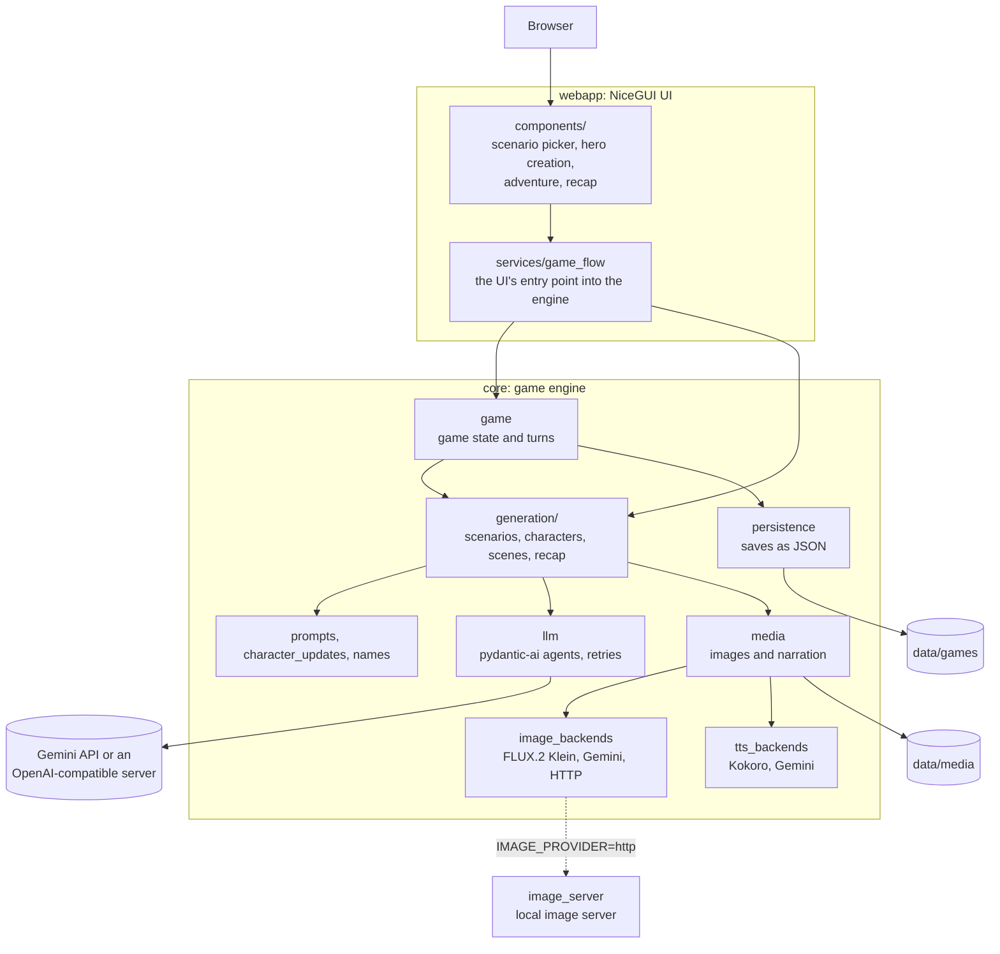
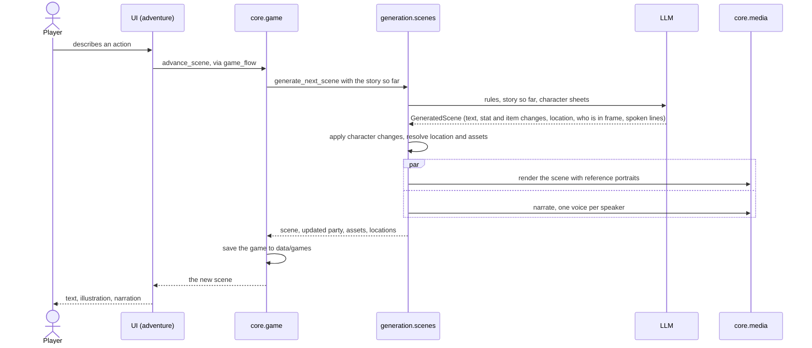

# Architecture

Generated Adventures is a NiceGUI web app on top of a game engine. The engine asks
an LLM to run the story as a dungeon master, applies what happened to the party,
and has image and voice models illustrate and narrate each scene.

## Components

## One turn

The LLM answers in a structured format (a pydantic model), not free text, so stat
changes, inventory changes and art direction arrive as data the engine can apply.

## Module guide

All code lives in `src/generated_adventures/`.

| Module | Responsibility |
|---|---|
| `webapp/components/` | One module per screen or widget. Reads models; calls `game_flow` for everything else. |
| `webapp/services/game_flow.py` | Thin async wrappers the UI calls: create and load games, generate scenarios and heroes, advance the story, recaps. |
| `webapp/main.py`, `webapp/cli.py` | App wiring (routes, static files, model warm-up) and the `adventures` command. |
| `core/game.py` | Game state in memory: turns, the party, saving after each change. |
| `core/generation/` | The LLM-driven steps: `scenarios`, `characters`, `scenes`, `recap`. |
| `core/prompts.py` | Prompt text: genre and stakes steering, scene rules, portrait cues. |
| `core/character_updates.py` | Applies a scene's health, stat, skill and inventory changes to the party. |
| `core/names.py` | Tolerant name matching, since LLMs don't always spell names the same way. |
| `core/llm.py` | The text model (Gemini or an OpenAI-compatible server) and the retry policy. |
| `core/media.py` | Shared image and voice model instances, media folders, scene and portrait rendering. |
| `core/image_backends.py` | FLUX.2 Klein (CUDA and Apple Silicon paths), Gemini, and the HTTP client for `image_server`. |
| `core/tts_backends.py`, `core/voice_casting.py` | Kokoro and Gemini narration; a consistent voice per character. |
| `core/persistence.py`, `core/models.py`, `core/config.py` | JSON saves, the pydantic data models, and settings from `.env`. |
| `image_server.py` | Optional local image server that keeps the image model loaded, on this machine or another one on your network. |

## Rules

These are checked in CI by [import-linter](https://github.com/seddonym/import-linter)
(`uv run lint-imports`; see `[tool.importlinter]` in `pyproject.toml`), so the
diagram above can't silently drift from the code:

1. The game engine (`core`) does not import the web UI.
2. UI components reach the engine only through `services/game_flow`. Reading
   models and config directly is allowed.
3. Generation steps do not import game state or persistence. `game` calls them, so
   the reverse would be a cycle.

## Where data lives

Everything a player creates lives under `DATA_DIR` (default `data/`, relative to
the working directory):

- `data/games/<game>.json`: one save per game.
- `data/scenarios/templates/`: generated scenarios, reusable across games.
- `data/media/{characters,scenes,voiceovers,assets,photos}/<game>/`: portraits,
  scene images, narration and uploaded player photos.

Saves refer to media by URL (`/static/scenes/<game>/<file>`), and the web app serves
`data/media` at `/static`. The app's own CSS is served at `/ui`.

Image and voice models are loaded once per process and shared. The web app starts
loading them in the background at startup, so the first scene doesn't wait for a
30-60 s model load.
